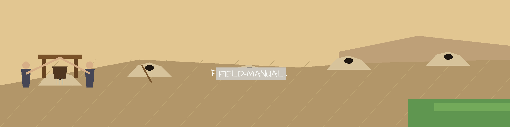
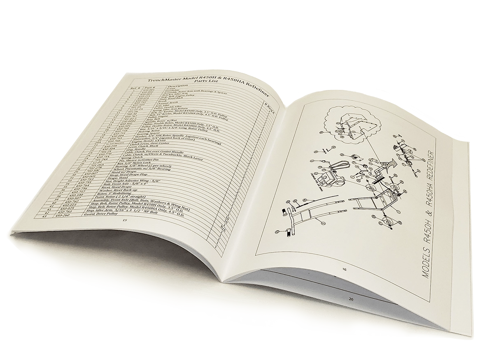

# Field-Manual

The field manuals I use at work, as a shopping and reference list. These are physical books, not downloads; each link goes to the book's Amazon product page.

## Security field manuals

- [LFM: Linux Field Manual, by Tim Bryant](https://www.amazon.com/dp/1736526723)
- [PTFM: Purple Team Field Manual](https://www.amazon.com/dp/B08LJV1QCD)
- [BTFM: Blue Team Field Manual](https://www.amazon.com/dp/154101636X)
- [RTFM: Red Team Field Manual](https://www.amazon.com/dp/1494295504)
- [RTRM: Red Team Reference Manual](https://www.amazon.com/dp/B08N37KDPQ)

## Desk references

- [Webster's portable dictionary, Second Edition](https://www.amazon.com/dp/0764564919)
- [Webster's All-in-One Dictionary and Thesaurus](https://www.amazon.com/dp/1596951478)

## Also on the shelf

- The ShadowSecuritySuite manual, downloaded and printed.

One thing I should say about that photo, since it sits right under the ShadowSecuritySuite line: it is not that manual, and it is not any book on this list. It shows a TrenchMaster Model R450H and R450HA ReDefiner parts list, open at pages 15 and 16.
